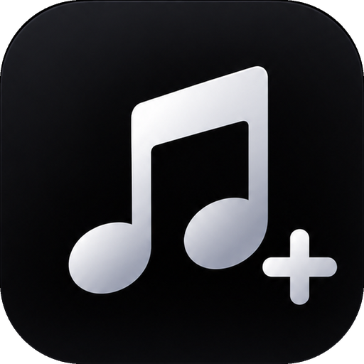

<div align="center">



# RamBox +

### 🎵 A modern, open-source music player for Android

Synced lyrics · Sing or hum to find a song · A clean black design

<br>


<br>

[⬇️ **Download**](https://github.com/raihan-dev404/RamBox-Plus/releases) &nbsp;•&nbsp;
[✨ **Features**](#-features) &nbsp;•&nbsp;
[🛠️ **Build it yourself**](#%EF%B8%8F-build-it-yourself) &nbsp;•&nbsp;
[🗺️ **Roadmap**](#%EF%B8%8F-roadmap)

</div>

---

## 👋 About

**RamBox +** is a free music app for Android, made by [**raihan-dev404**](https://github.com/raihan-dev404).
It is built with Kotlin and Jetpack Compose, with a black design that is easy on the eyes and smooth animations everywhere.

No ads. No sign-up. Free forever.

---

## ✨ Features

| | Feature | What it does |
|---|---|---|
| 🎶 | **Music player** | Stream and play music with a queue, downloads and a full-screen player. |
| 📝 | **Synced lyrics** | Lyrics that follow the song line by line. |
| 🎤 | **Sing or hum to find a song** | Tap the mic, sing or hum, and RamBox + finds the song. A ring of bars moves with your voice, the result breaks onto the screen, and the best matches get 🥇 🥈 🥉 with a match percentage. Tap one to play it. |
| 👂 | **Song recognition** | Find a song that is playing nearby. |
| 🎛️ | **Equalizer & Audio Lab** | Shape the sound the way you like it. |
| 🎨 | **App icons** | Pick your icon: Default, Gradient, White, Transparent or Ocean. |
| 🖤 | **Clean black design** | Material 3, smooth, and made for phones. |
| 🔗 | **Integrations** | Discord presence and Last.fm. |

---

## 🎤 Sing or hum

1. Open the **Home** screen and tap the **mic** icon at the top.
2. Tap the big mic in the middle and **sing or hum** the tune.
3. As soon as a song is found, the ring breaks apart and the matches rise from the bottom.
4. The top three are **gold, silver and bronze**, and the **percentage** on the right shows how sure the match is.
5. Tap a song to **play** it.

---

## ⬇️ Download

Get the latest APK from the [**Releases**](https://github.com/raihan-dev404/RamBox-Plus/releases) page, then open it on your phone and install it.
You may need to allow **Install unknown apps** for your browser or file manager.

---

## 🛠️ Build it yourself

**You need:** [Android Studio](https://developer.android.com/studio) (latest stable).

1. Clone the project:
   ```bash
   git clone https://github.com/raihan-dev404/RamBox-Plus.git
   ```
2. Open the **RamBox-Plus** folder in Android Studio and let Gradle sync.
3. *(Optional)* To turn on sing/hum recognition, copy `local.properties.example` to `local.properties` and fill in your own [ACRCloud](https://www.acrcloud.com/) project keys:
   ```properties
   ACR_HOST=identify-eu-west-1.acrcloud.com
   ACR_ACCESS_KEY=your-access-key
   ACR_ACCESS_SECRET=your-access-secret
   ```
   The project needs **Audio Fingerprinting & Cover Song (Humming) Identification** turned on.
4. Choose the `app` module and press **Run ▶️**, or from a terminal:
   ```bash
   ./gradlew assembleDebug
   ```

> 🔐 `local.properties` is private and is never uploaded. Keys inside a built APK can be extracted, so do not share an APK built with your own keys.

---

## 🧰 Built with

- **Kotlin**
- **Jetpack Compose** and **Material 3**
- **Media3 / ExoPlayer**
- **Coroutines & Flow**
- **ACRCloud** for hum recognition

---

## 🗺️ Roadmap

- [x] Rebrand, new logo and five app icons
- [x] Sing / hum recognition with a live animation
- [ ] A better recognition service
- [ ] More languages for lyrics
- [ ] More player styles

Have an idea? Open an [issue](https://github.com/raihan-dev404/RamBox-Plus/issues).

---

## 🤝 Contributing

Bug reports and ideas are welcome. Open an issue first to talk about what you would like to change.

---

## 📜 License

RamBox + is released under the **GNU General Public License v3.0**. See [LICENSE](LICENSE) for the full text.
It is built on open-source code that is released under the same licence.

<div align="center">

<br>

Made with 🖤 by [**raihan-dev404**](https://github.com/raihan-dev404)

⭐ If you like RamBox +, give the repo a star!

</div>
